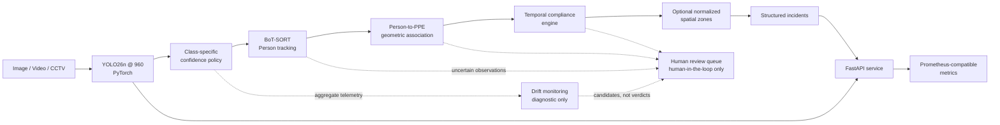

# VisionOps PPE

VisionOps PPE is a production-oriented computer-vision prototype for detecting construction PPE evidence and converting video observations into track-aware, temporally validated incidents. It goes beyond a detector demo with controlled domain experiments, calibrated thresholds, tracking, explicit uncertainty, monitoring, human review, an API, and reproducible packaging.

> This is a safety-assistance prototype, not a certified safety system. Human oversight and deployment-specific validation are required.

## What it does

Images or video pass through a frozen PyTorch YOLO26n detector at 960 pixels. Class-specific thresholds filter detections; BoT-SORT tracks people; deterministic geometry associates PPE with each anonymous, run-local track; temporal rules distinguish unknown, conflict, suspected, confirmed, and cleared states; optional normalized-image zones control where equipment rules apply. Missing evidence means `unknown`, not a violation.

## Demo

**YouTube demos:** [Watch the VisionOps PPE demo playlist](https://www.youtube.com/playlist?list=PLOi5iik86yrY)

Two short side-by-side demonstrations show the production pipeline on real video.

### Multi-worker tracking

Stable run-local person tracks through camera motion, with per-person Helmet/Vest association.

[Watch the multi-worker tracking demo](docs/demo/camera_transition_workers_side_by_side.mp4)

### Temporal compliance and incident detection

Shows timestamp-driven compliance progression from `SUSPECT` to `VIOLATION` and incident generation.

https://github.com/user-attachments/assets/8bb27949-8546-405e-9974-19182fe64bed

> Track IDs are anonymous and run-local. Short occlusions are handled substantially better after continuity tuning, but severe crowd overlap or merged Person detections can still fragment tracks.

## Architecture



See [architecture.md](docs/architecture.md) for component and safety boundaries.

## Why this project is different

- Real-video tracking, per-person PPE association, temporal persistence, and zone-aware incidents.
- Bounded BoT-SORT/ReID comparison prompted by an observed identity-transfer failure.
- Strict ONNX behavioral parity testing, robustness stress tests, and honest negative results.
- PSI drift telemetry validated as shift detection—not an accuracy-failure predictor.
- Deduplicated human review queue with no automatic labeling or retraining.
- Hash-verified FastAPI runtime, Prometheus metrics, upload controls, and Docker packaging.

## Key results

| Result | Value | Interpretation |
|---|---:|---|
| Final detector, Construction-PPE mAP50-95 | **0.6642** | Five-class source validation |
| Final detector, filtered RF100 mAP50-95 | **0.4948** | Held-out target-domain validation for the mixed model |
| RF100 mAP50-95: source-only A → exposure-matched D → full mixed C | 0.3349 → 0.4722 → **0.4948** | Diversity drove most of the gain |
| Calibrated operational F1, Construction-PPE / RF100 | **0.9020 / 0.9073** | Frozen class-specific policy |
| Review queue | 1,137 raw → **28** | Timestamp, perceptual, and budget deduplication |

The public demo clips provide qualitative integration evidence; they are not an annotated accuracy or formal MOT benchmark. See [experiment_summary.md](docs/experiment_summary.md) and [docs/experiments](docs/experiments).

## Training and experimentation

The final model was selected through controlled experiments rather than a single training run:

- Established a YOLO26n baseline at 640px, then moved to 960px after improved small-PPE recall and mAP50-95.
- Tested YOLO26s to determine whether additional model capacity improved generalization; it improved source-domain accuracy but did not improve external-domain performance enough to justify the added latency.
- Evaluated the source-trained detector on RF100 and identified a substantial domain-shift gap.
- Added target-domain training data and ran a matched-exposure control to separate the effect of data diversity from simply training on more samples.
- Improved filtered RF100 validation mAP50-95 from **0.3349 to 0.4948** while retaining **0.6642** on Construction-PPE validation.
- Calibrated class-specific operating thresholds across both validation domains, reaching **0.9020 / 0.9073 F1**.
- Compared ByteTrack, BoT-SORT, and appearance-ReID variants on real video; selected BoT-SORT without ReID after targeted failure analysis.
- Evaluated ONNX as a deployment backend, but retained PyTorch after parity and latency tests failed the production acceptance criteria.

### Selected decision evidence

| Decision | Measured evidence | Outcome |
|---|---|---|
| [640 → 960 resolution](docs/experiments/resolution_960/comparison.md) | mAP50-95 `0.5461 → 0.6012`; tiny-object recall `+0.150` | Selected 960px |
| [YOLO26n vs YOLO26s](docs/experiments/model_capacity_960/comparison.md) + [external evaluation](docs/experiments/external_generalization/comparison.md) | YOLO26s improved source accuracy, but external mAP50-95 was `0.3012` vs `0.3029` for YOLO26n with roughly 2× inference cost | Retained YOLO26n |
| [Target-domain diversity](docs/experiments/data_diversity_exposure_control/comparison.md) | RF100 mAP50-95: source-only `0.3349` → exposure-matched `0.4722` → full mixed `0.4948` | Selected mixed-source training |
| [Operating-point calibration](docs/experiments/final_model_selection/calibration.md) | Construction-PPE / RF100 F1: `0.9020 / 0.9073` | Froze class-specific thresholds |
| [Tracker comparison](docs/experiments/tracker_robustness/comparison.md) | BoT-SORT avoided the primary transfer failure; appearance ReID showed no meaningful visual benefit | Selected BoT-SORT without ReID |
| [Deployment backend](docs/experiments/deployment_optimization/decision.md) | ONNX failed strict output parity and was slower in the controlled benchmark | Retained PyTorch |

Detailed protocols and results are available in [experiment_summary.md](docs/experiment_summary.md) and [docs/experiments](docs/experiments).

## Production pipeline

Production classes are `helmet`, `vest`, `Person`, `no_helmet`, and `no_vest`. Temporal confirmation, clearing, cooldown, track expiry, and optional zone applicability produce auditable incident events. Track IDs are local technical identifiers, never worker identity. Production BoT-SORT keeps the reportable Person evidence threshold at `0.41`; lower-confidence Person candidates down to `0.11` support track continuity only, with sparse-optical-flow motion compensation and no appearance ReID.

## Deployment, robustness, and monitoring

PyTorch is the production backend. ONNX FP32 was rejected because it failed strict final-detection/downstream parity and was slower in the controlled detector benchmark. TensorRT was not forced into an incompatible stack and is not claimed as validated.

Gaussian noise and motion blur were the largest synthetic weaknesses. Simple PSI signals detected distribution changes but correlated poorly with measured accuracy loss and over-alerted on limited real footage; drift is therefore diagnostic-only.

## Human review

Uncertain detections, association ambiguity, conflicts, unknown states, incidents, tracking events, and drift windows can nominate candidates. A transparent score plus temporal and perceptual-hash deduplication reduces review load. Human fields remain blank until review, and export never changes training manifests or launches retraining.

## Quickstart

Python 3.11 or 3.12 is required. The frozen weight is intentionally ignored by Git and must be placed at `runs/experiment_mixed5_yolo26n_960/weights/best.pt`; startup verifies SHA-256 `BF99E872A9B57A7C33A4EBF06F0620F9EB8A215AEC29DDE2A90CA1F72F9581F4`.

```powershell
py -3.12 -m venv .venv
.\.venv\Scripts\Activate.ps1
python -m pip install --upgrade pip
python -m pip install -e ".[dev,service]"
pytest
ruff check .
ruff format --check .
```

Run the full video pipeline:

```powershell
python scripts\run_video_inference.py --source demo.mp4 `
  --output-dir results\demo --enable-tracking `
  --enable-ppe-association --enable-temporal-compliance `
  --zones configs\zones\example_zones.yaml --render
```

Start the API:

```powershell
python scripts\hash_admin_password.py
uvicorn visionops.api.app:app --host 127.0.0.1 --port 8000
curl.exe http://127.0.0.1:8000/health/ready
```

Set `ADMIN_USERNAME`, `ADMIN_PASSWORD_HASH`, and `SESSION_SECRET` before starting
the administrator interface. See
[portfolio_deployment.md](docs/portfolio_deployment.md) for local and Nginx
deployment preparation, [docker_deployment.md](docs/docker_deployment.md) for
the GPU Docker workflow, and [demo.md](docs/demo.md) for pipeline artifacts.

## API

Public routes are `/` and `/watch/{video_id}`; they expose only completed videos
explicitly published by the administrator. Private routes begin at `/admin` and
`/api/admin/videos`. Existing `/v1` job/config endpoints and `/metrics` remain
available to an authenticated administrator. Long videos use the existing
bounded single-node job queue.

## Repository structure

```text
configs/                frozen production and experiment configuration
docs/                   cards, decisions, guides, and experiment lineage
scripts/                audits, experiments, diagnostics, demo, and export entrypoints
src/visionops/          pipeline, tracking, association, compliance, API, monitoring
tests/                  deterministic unit and CPU integration tests
data/, runs/, results/  local ignored datasets, weights, media, and artifacts
```

## Limitations

- No sealed deployment-representative test set or formal real-world accuracy study exists.
- RF100 validation became target-domain development evidence for the mixed model; its small test split was used earlier for model-family diagnosis and is not pristine final evidence.
- Sparse RF100 `no_helmet` labels limit confidence in that class.
- Track fragmentation and duplicate tracks remain possible under overlap/occlusion.
- Zones are normalized image-plane polygons, not calibrated world coordinates.
- Drift does not prove failure; low drift does not prove correctness.
- The local and Docker job queues are single-process and are not distributed.
- Internal real-video provenance is unresolved; no questionable footage is embedded here.

## License, datasets, and media

No repository code license has been chosen and there is no `LICENSE` file. Construction-PPE and RF100 Construction Safety v2 are CC BY 4.0 and require separate attribution; datasets and model weights are not redistributed. Ultralytics, PyTorch, OpenCV, and other dependencies retain their upstream licenses. Selected portfolio demo media under `docs/demo/` and GitHub-hosted attachments is intentionally public; other internal or local validation media remains excluded from the repository. This public selection does not establish or expand any underlying footage rights. See [dataset_card.md](docs/dataset_card.md) and [project_status.md](docs/project_status.md).
