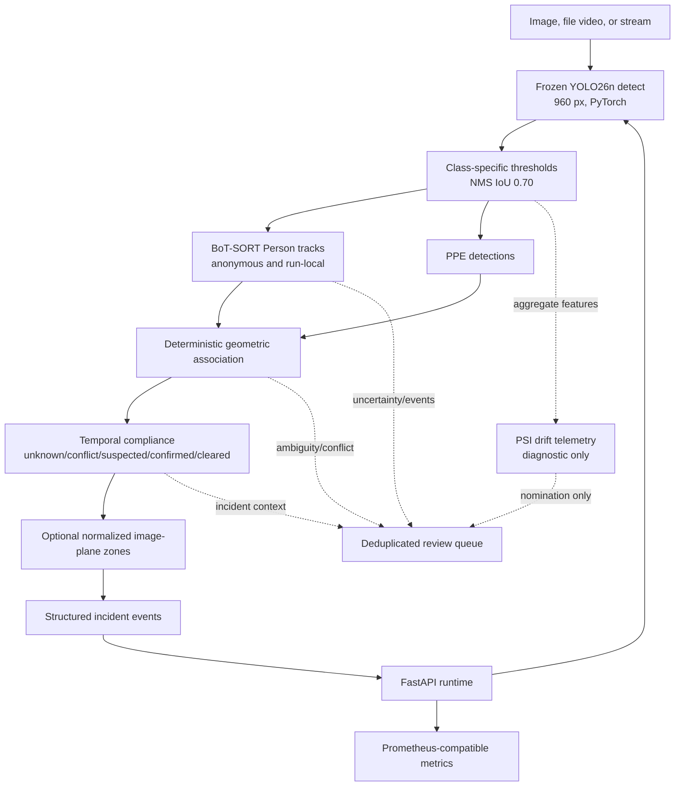

# System architecture

The solid perception path determines evidence and incidents. Drift never controls inference, incidents, or retraining. Review candidates require a human verdict and do not automatically become training annotations. Track IDs are not identities. Zone geometry is image-normalized and does not imply world-coordinate calibration.
