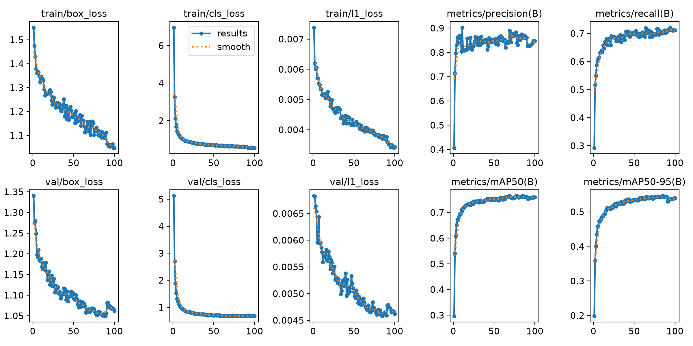
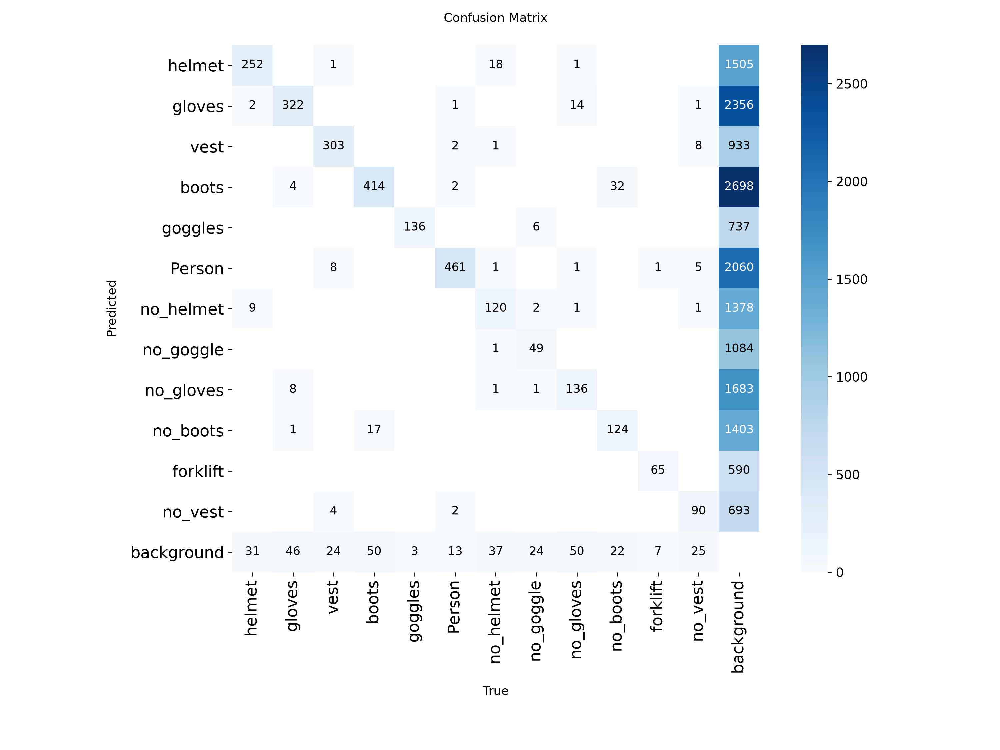
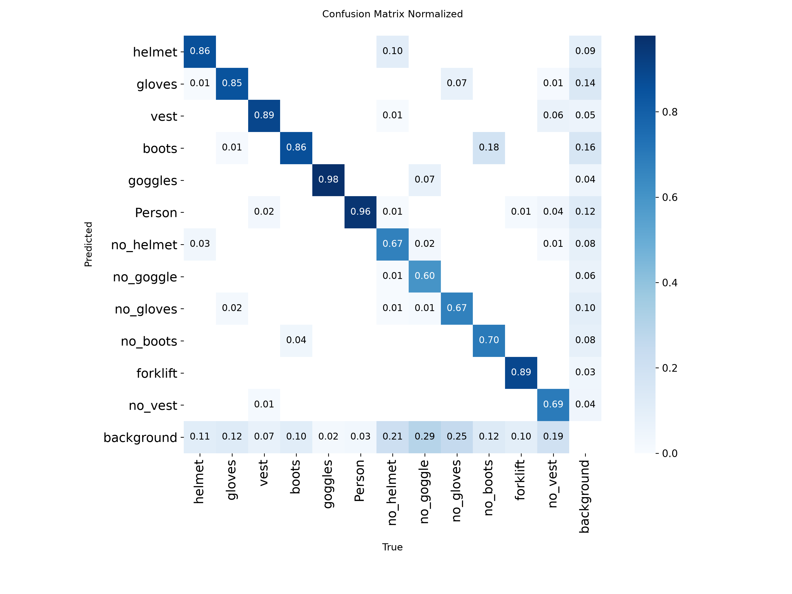
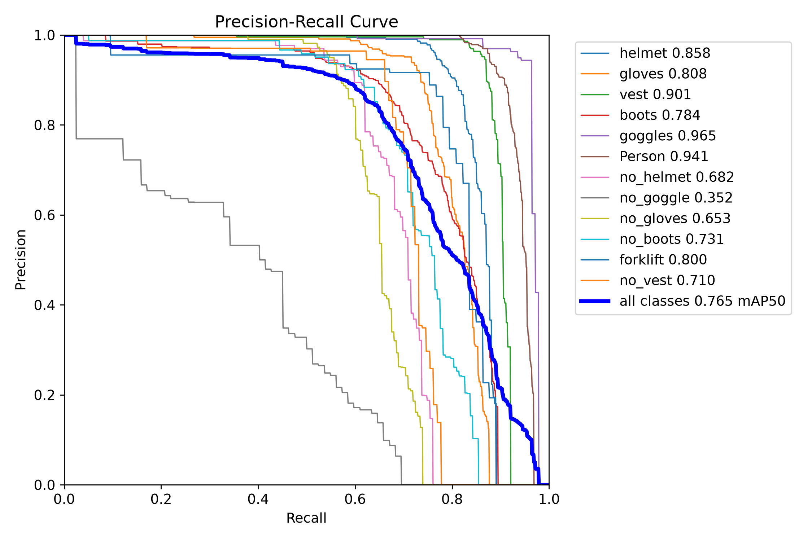
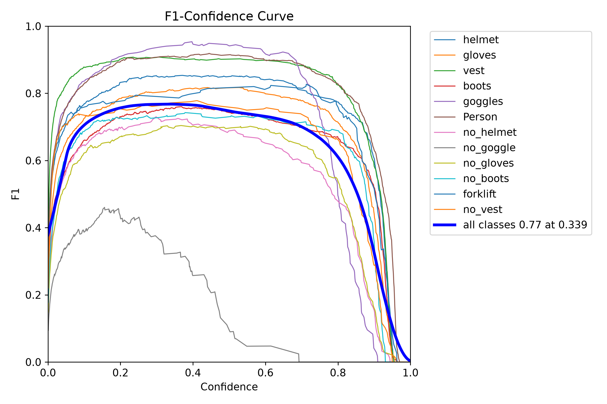
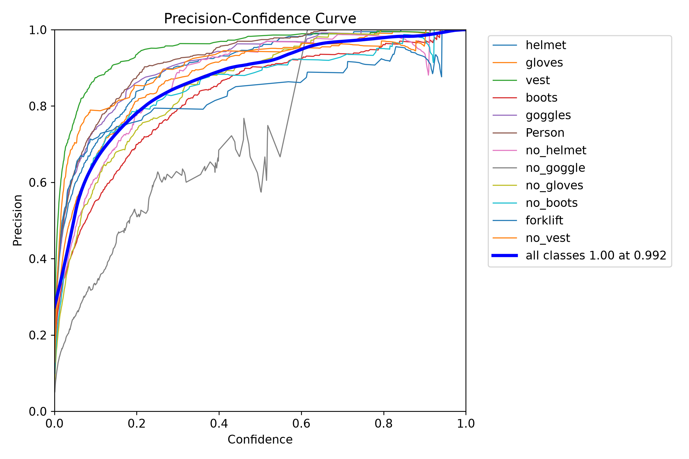
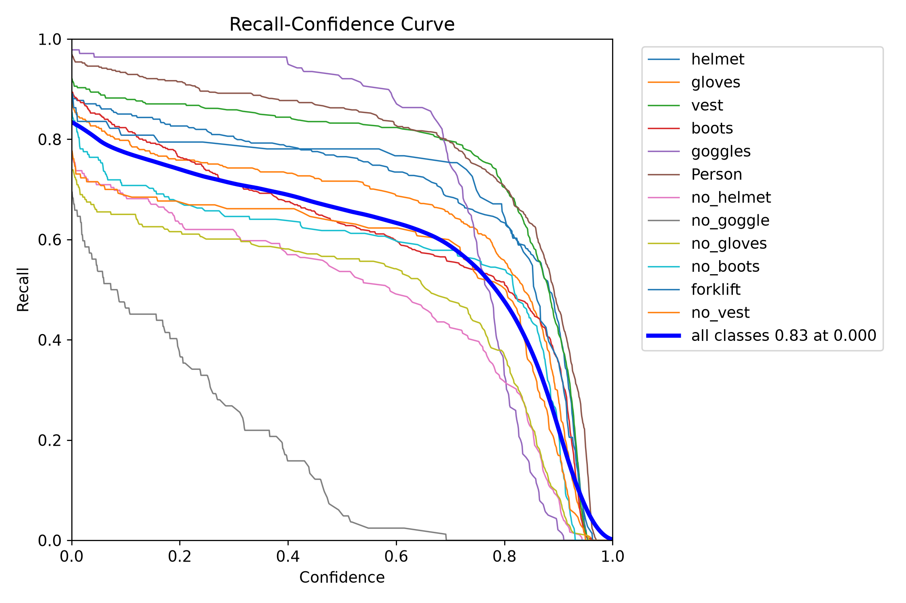

# YOLO26n 640 baseline

## 1. Objective

Establish one reproducible pretrained YOLO26n baseline on all 12 Construction-PPE classes. No tuning or class rebalancing was performed.

## 2. Exact training configuration

| Setting | Value |
| --- | --- |
| `model` | `yolo26n.pt` |
| `data` | `E:\visionops-ppe\data\construction-ppe\data.yaml` |
| `epochs` | `100` |
| `imgsz` | `640` |
| `batch` | `8` |
| `device` | `0` |
| `seed` | `42` |
| `deterministic` | `True` |
| `patience` | `20` |
| `amp` | `True` |
| `workers` | `4` |
| `cache` | `False` |

All unlisted optimizer, learning-rate schedule, augmentation, loss, and mosaic settings used Ultralytics 8.4.212 defaults.

## 3. Hardware and software environment

- GPU: NVIDIA GeForce RTX 3050 6GB Laptop GPU
- Python: 3.12.6
- PyTorch: 2.5.1+cu121
- PyTorch CUDA runtime: 12.1
- Ultralytics: 8.4.212
- Platform: Windows-11-10.0.26200-SP0

## 4. Overall validation metrics

| Precision | Recall | mAP50 | mAP50-95 |
| ---: | ---: | ---: | ---: |
| 0.866748 | 0.702127 | 0.765409 | 0.546142 |

## 5. Per-class metrics

| Class | Precision | Recall | AP50 | AP50-95 |
| --- | ---: | ---: | ---: | ---: |
| `helmet` | 0.915191 | 0.792517 | 0.858389 | 0.661449 |
| `gloves` | 0.892464 | 0.740611 | 0.808161 | 0.622705 |
| `vest` | 0.963450 | 0.852814 | 0.901380 | 0.711783 |
| `boots` | 0.827390 | 0.696466 | 0.784234 | 0.580106 |
| `goggles` | 0.919721 | 0.964029 | 0.965055 | 0.643872 |
| `Person` | 0.932765 | 0.887734 | 0.941210 | 0.784199 |
| `no_helmet` | 0.911040 | 0.597765 | 0.681626 | 0.415832 |
| `no_goggle` | 0.611394 | 0.219512 | 0.351606 | 0.084461 |
| `no_gloves` | 0.856640 | 0.588721 | 0.652583 | 0.400870 |
| `no_boots` | 0.853539 | 0.640449 | 0.731263 | 0.571044 |
| `forklift` | 0.792197 | 0.783366 | 0.799839 | 0.585581 |
| `no_vest` | 0.925192 | 0.661538 | 0.709558 | 0.491805 |

## 6. Training behavior

- Actual batch size: 8
- Final epoch reached: 100
- Best epoch: 86
- Early stopping occurred: False
- Training duration: 00:44:51
- Peak allocated GPU memory: 1.380 GiB
- Validation speed: preprocess 0.800 ms, inference 6.406 ms, loss 0.001 ms, postprocess 1.048 ms per image

## 7. Best-performing classes

- `Person`: AP50-95 0.784199
- `vest`: AP50-95 0.711783
- `helmet`: AP50-95 0.661449

## 8. Worst-performing classes

- `no_goggle`: AP50-95 0.084461
- `no_gloves`: AP50-95 0.400870
- `no_helmet`: AP50-95 0.415832

## 9. Observations

- The measured validation mAP50-95 is 0.546142.
- `Person` has the highest measured AP50-95; `no_goggle` has the lowest.
- The earlier dataset audit found that 67.34% of boxes have relative area below 1%, and 27.17% have relative area below 0.1%. This baseline does not attempt to address that distribution.

## 10. Evaluation scope

These metrics use the official validation split, which is development data. It is not an independent final test set and must not be treated as a deployment-performance estimate.

## Curated plots

