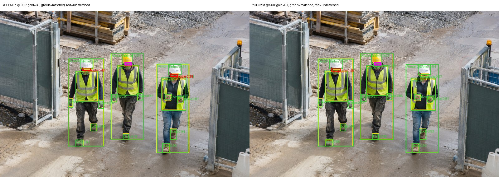
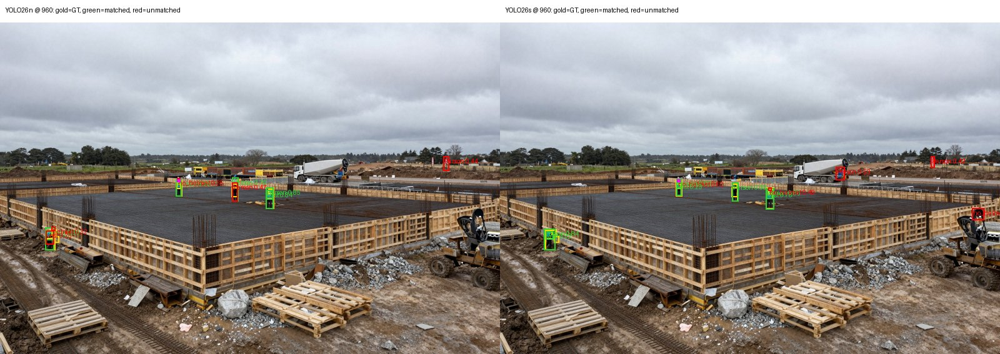
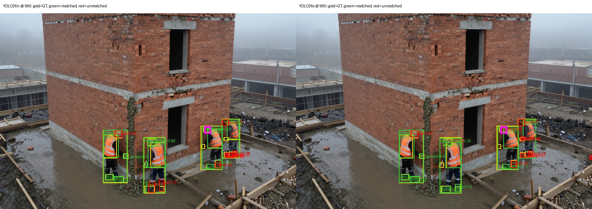
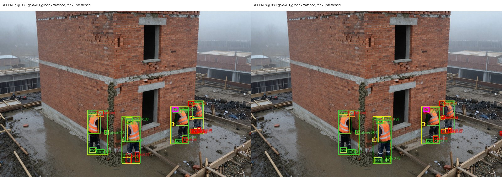
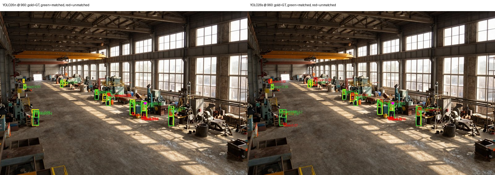

# YOLO26n versus YOLO26s at 960

## Experimental control

Only model capacity changed. Resolution, dataset, split, classes, epochs, seed, optimizer behavior, augmentation, loss settings, and diagnostic thresholds remained fixed.

## Overall comparison

| Metric | YOLO26n | YOLO26s | Delta / ratio |
| --- | ---: | ---: | ---: |
| Precision | 0.881174 | 0.890876 | +0.009702 |
| Recall | 0.778126 | 0.805689 | +0.027564 |
| mAP50 | 0.826855 | 0.856123 | +0.029268 |
| mAP50-95 | 0.601224 | 0.634256 | +0.033033 |
| Inference latency (ms/image) | 10.963992 | 22.306464 | 2.035x |
| Total processing latency (ms/image) | 13.756079 | 26.023360 | 1.892x |
| Peak allocated GPU memory (GiB) | 3.045 | 5.341 | 1.754x |
| Peak reserved GPU memory (GiB) | 3.459 | 5.965 | 1.724x |
| Parameters | 2539232.000 | 9957152.000 | 3.921x |
| GFLOPs at 960 | 13.974 | 51.962 | 3.719x |
| Pretrained size (MiB) | 5.288 | 19.477 | 3.683x |
| Best checkpoint size (MiB) | 5.236 | 19.407 | 3.707x |

Relative mAP50-95 gain: 5.49%.

## Complete per-class comparison

| Class | n AP50-95 | s AP50-95 | Delta | n recall | s recall | Delta |
| --- | ---: | ---: | ---: | ---: | ---: | ---: |
| `helmet` | 0.732529 | 0.762118 | +0.029589 | 0.860383 | 0.884354 | +0.023971 |
| `gloves` | 0.701862 | 0.744542 | +0.042681 | 0.805774 | 0.828667 | +0.022893 |
| `vest` | 0.764280 | 0.785274 | +0.020994 | 0.912614 | 0.935294 | +0.022680 |
| `boots` | 0.652719 | 0.672995 | +0.020276 | 0.773110 | 0.808732 | +0.035622 |
| `goggles` | 0.681057 | 0.746811 | +0.065755 | 0.971223 | 0.961071 | -0.010152 |
| `Person` | 0.821949 | 0.857753 | +0.035804 | 0.941788 | 0.960499 | +0.018711 |
| `no_helmet` | 0.454117 | 0.500258 | +0.046141 | 0.681564 | 0.735091 | +0.053526 |
| `no_goggle` | 0.163861 | 0.204372 | +0.040511 | 0.439024 | 0.542084 | +0.103060 |
| `no_gloves` | 0.464408 | 0.498046 | +0.033638 | 0.709750 | 0.699507 | -0.010243 |
| `no_boots` | 0.639256 | 0.682173 | +0.042917 | 0.704975 | 0.769663 | +0.064688 |
| `forklift` | 0.606131 | 0.626644 | +0.020514 | 0.821918 | 0.835616 | +0.013699 |
| `no_vest` | 0.532518 | 0.530089 | -0.002429 | 0.715385 | 0.707692 | -0.007692 |

### Focus classes

- `helmet`: AP50-95 0.732529 -> 0.762118 (+0.029589); recall 0.860383 -> 0.884354 (+0.023971).
- `vest`: AP50-95 0.764280 -> 0.785274 (+0.020994); recall 0.912614 -> 0.935294 (+0.022680).
- `no_helmet`: AP50-95 0.454117 -> 0.500258 (+0.046141); recall 0.681564 -> 0.735091 (+0.053526).
- `no_vest`: AP50-95 0.532518 -> 0.530089 (-0.002429); recall 0.715385 -> 0.707692 (-0.007692).
- `gloves`: AP50-95 0.701862 -> 0.744542 (+0.042681); recall 0.805774 -> 0.828667 (+0.022893).
- `no_gloves`: AP50-95 0.464408 -> 0.498046 (+0.033638); recall 0.709750 -> 0.699507 (-0.010243).
- `goggles`: AP50-95 0.681057 -> 0.746811 (+0.065755); recall 0.971223 -> 0.961071 (-0.010152).
- `no_goggle`: AP50-95 0.163861 -> 0.204372 (+0.040511); recall 0.439024 -> 0.542084 (+0.103060).

## Size-stratified fixed-threshold recall

Confidence 0.25; matching IoU 0.50; NMS IoU 0.70.

| Scope | Size | GT | n matched | n recall | s matched | s recall | Delta |
| --- | --- | ---: | ---: | ---: | ---: | ---: | ---: |
| `overall` | tiny | 801 | 380 | 0.474407 | 463 | 0.578027 | +0.103620 |
| `overall` | small | 1203 | 1115 | 0.926850 | 1141 | 0.948462 | +0.021613 |
| `overall` | large | 957 | 933 | 0.974922 | 928 | 0.969697 | -0.005225 |
| `helmet` | tiny | 124 | 90 | 0.725806 | 92 | 0.741935 | +0.016129 |
| `helmet` | small | 78 | 75 | 0.961538 | 76 | 0.974359 | +0.012821 |
| `helmet` | large | 92 | 92 | 1.000000 | 92 | 1.000000 | +0.000000 |
| `no_helmet` | tiny | 84 | 42 | 0.500000 | 53 | 0.630952 | +0.130952 |
| `no_helmet` | small | 46 | 36 | 0.782609 | 37 | 0.804348 | +0.021739 |
| `no_helmet` | large | 49 | 48 | 0.979592 | 48 | 0.979592 | +0.000000 |
| `vest` | tiny | 64 | 40 | 0.625000 | 46 | 0.718750 | +0.093750 |
| `vest` | small | 114 | 111 | 0.973684 | 112 | 0.982456 | +0.008772 |
| `vest` | large | 162 | 160 | 0.987654 | 160 | 0.987654 | +0.000000 |
| `no_vest` | tiny | 33 | 4 | 0.121212 | 5 | 0.151515 | +0.030303 |
| `no_vest` | small | 26 | 19 | 0.730769 | 20 | 0.769231 | +0.038462 |
| `no_vest` | large | 71 | 70 | 0.985915 | 68 | 0.957746 | -0.028169 |
| `goggles` | tiny | 2 | 1 | 0.500000 | 1 | 0.500000 | +0.000000 |
| `goggles` | small | 126 | 123 | 0.976190 | 122 | 0.968254 | -0.007937 |
| `goggles` | large | 11 | 11 | 1.000000 | 10 | 0.909091 | -0.090909 |
| `no_goggle` | tiny | 54 | 17 | 0.314815 | 28 | 0.518519 | +0.203704 |
| `no_goggle` | small | 28 | 23 | 0.821429 | 23 | 0.821429 | +0.000000 |
| `no_goggle` | large | 0 | 0 | 0.000000 | 0 | 0.000000 | +0.000000 |

## Training behavior

- Actual YOLO26s batch: 8
- Epochs completed: 100
- Best epoch: 91
- Duration: 10606.120 seconds

## Tradeoff judgment

- Absolute mAP50-95 gain: +0.033033
- Relative mAP50-95 gain: 5.49%
- Absolute recall gain: +0.027564
- Tiny-object recall gain: +0.103620
- Inference-latency ratio: 2.035x
- Peak allocated-memory ratio: 1.754x
- Parameter-count ratio: 3.921x

## Representative failures and changes

Gold boxes are ground truth, green predictions are matched, red predictions are unmatched, and magenta marks the focal object.

- YOLO26n missed; YOLO26s detected: `vest`, relative area 0.000174.
  
- YOLO26n missed; YOLO26s detected: `no_goggle`, relative area 0.000538.
  
- both models missed: `no_helmet`, relative area 0.000108.
  
- both models missed: `no_goggle`, relative area 0.000292.
  
- YOLO26s introduced false positive: `no_helmet`, relative area 0.000047.
  
- YOLO26s introduced false positive: `helmet`, relative area 0.000858.
  
- YOLO26n detected; YOLO26s missed: `no_helmet`, relative area 0.000730.
  
- YOLO26n detected; YOLO26s missed: `helmet`, relative area 0.000105.
  

## Limitations

This is a one-seed comparison on the development validation split. The fixed-threshold size diagnostic is not AP, and sparse bins must be interpreted with their counts. A reduced batch after a genuine OOM is documented as a comparability limitation if it occurred.

## Conclusion

**A. YOLO26s materially improves difficult-class and small-object performance enough to justify its compute cost.**

The additional capacity raises model-only latency and resource use substantially, but it remains below 23 ms/image on this GPU while producing a material tiny-object recall gain and positive AP50-95 movement in seven of the eight focus classes. This conclusion is for the measured GPU deployment context, not an unconstrained preference for the larger model.

Decision rule: A requires AP50-95 delta >=0.025, tiny or small recall delta >=0.05, positive AP50-95 deltas for at least 6/8 focus classes, and latency ratio <=2.5. B requires positive AP50-95 and either positive tiny/small recall or at least 5/8 positive focus classes. Otherwise C.
