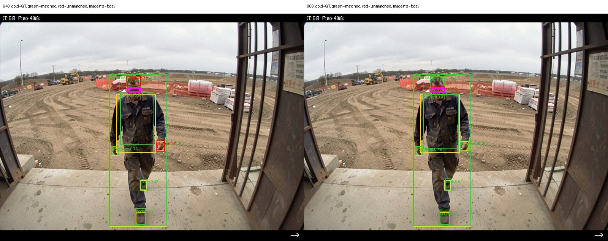
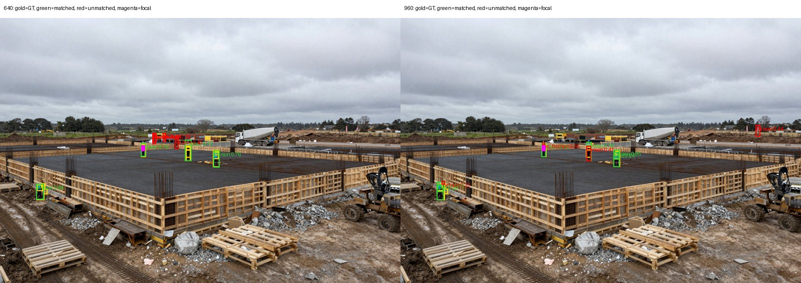
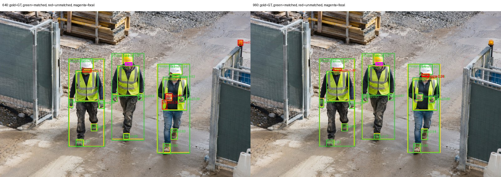
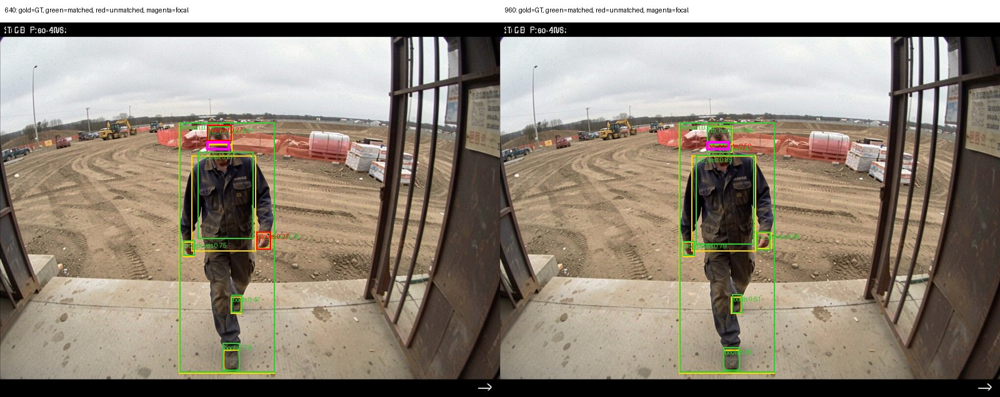

# YOLO26n 960 controlled resolution experiment

## Objective and control

Test whether changing only input resolution from 640 to 960 improves small-PPE and missing-PPE detection enough to justify its latency cost. Model, data, classes, epochs, seed, optimizer, schedule, augmentation, loss settings, and all other controlled training settings are unchanged.

## 960 training behavior

- Actual batch size: 8
- Epochs completed: 100
- Best epoch: 91
- Training duration: 5581.867 seconds
- Early stopping: False

## Overall validation comparison

| Metric | 640 baseline | 960 experiment | Absolute delta |
| --- | ---: | ---: | ---: |
| Precision | 0.866748 | 0.881174 | +0.014426 |
| Recall | 0.702127 | 0.778126 | +0.075999 |
| mAP50 | 0.765409 | 0.826855 | +0.061446 |
| mAP50-95 | 0.546142 | 0.601224 | +0.055082 |
| Inference latency (ms/image) | 6.405697 | 10.963992 | +4.558295 |

## Per-class comparison

| Class | 640 AP50-95 | 960 AP50-95 | Delta | 640 recall | 960 recall | Delta |
| --- | ---: | ---: | ---: | ---: | ---: | ---: |
| `helmet` | 0.661449 | 0.732529 | +0.071079 | 0.792517 | 0.860383 | +0.067866 |
| `gloves` | 0.622705 | 0.701862 | +0.079157 | 0.740611 | 0.805774 | +0.065163 |
| `vest` | 0.711783 | 0.764280 | +0.052497 | 0.852814 | 0.912614 | +0.059800 |
| `boots` | 0.580106 | 0.652719 | +0.072613 | 0.696466 | 0.773110 | +0.076644 |
| `goggles` | 0.643872 | 0.681057 | +0.037185 | 0.964029 | 0.971223 | +0.007194 |
| `Person` | 0.784199 | 0.821949 | +0.037749 | 0.887734 | 0.941788 | +0.054054 |
| `no_helmet` | 0.415832 | 0.454117 | +0.038285 | 0.597765 | 0.681564 | +0.083799 |
| `no_goggle` | 0.084461 | 0.163861 | +0.079400 | 0.219512 | 0.439024 | +0.219512 |
| `no_gloves` | 0.400870 | 0.464408 | +0.063539 | 0.588721 | 0.709750 | +0.121029 |
| `no_boots` | 0.571044 | 0.639256 | +0.068212 | 0.640449 | 0.704975 | +0.064526 |
| `forklift` | 0.585581 | 0.606131 | +0.020550 | 0.783366 | 0.821918 | +0.038551 |
| `no_vest` | 0.491805 | 0.532518 | +0.040713 | 0.661538 | 0.715385 | +0.053846 |

### Requested focus classes

- `helmet`: AP50-95 0.661449 -> 0.732529 (+0.071079); recall 0.792517 -> 0.860383 (+0.067866).
- `vest`: AP50-95 0.711783 -> 0.764280 (+0.052497); recall 0.852814 -> 0.912614 (+0.059800).
- `goggles`: AP50-95 0.643872 -> 0.681057 (+0.037185); recall 0.964029 -> 0.971223 (+0.007194).
- `no_helmet`: AP50-95 0.415832 -> 0.454117 (+0.038285); recall 0.597765 -> 0.681564 (+0.083799).
- `no_vest`: AP50-95 0.491805 -> 0.532518 (+0.040713); recall 0.661538 -> 0.715385 (+0.053846).
- `no_goggle`: AP50-95 0.084461 -> 0.163861 (+0.079400); recall 0.219512 -> 0.439024 (+0.219512).
- `no_gloves`: AP50-95 0.400870 -> 0.464408 (+0.063539); recall 0.588721 -> 0.709750 (+0.121029).

## Size-stratified fixed-threshold recall

Confidence threshold: 0.25. Matching IoU: 0.50. NMS IoU: 0.70.

| Scope | Size | GT count | 640 matched | 640 recall | 960 matched | 960 recall | Delta |
| --- | --- | ---: | ---: | ---: | ---: | ---: | ---: |
| `overall` | tiny | 801 | 263 | 0.328340 | 383 | 0.478152 | +0.149813 |
| `overall` | small | 1203 | 1069 | 0.888612 | 1114 | 0.926018 | +0.037406 |
| `overall` | large | 957 | 926 | 0.967607 | 933 | 0.974922 | +0.007315 |
| `helmet` | tiny | 124 | 69 | 0.556452 | 91 | 0.733871 | +0.177419 |
| `helmet` | small | 78 | 75 | 0.961538 | 75 | 0.961538 | +0.000000 |
| `helmet` | large | 92 | 92 | 1.000000 | 92 | 1.000000 | +0.000000 |
| `no_helmet` | tiny | 84 | 24 | 0.285714 | 41 | 0.488095 | +0.202381 |
| `no_helmet` | small | 46 | 36 | 0.782609 | 36 | 0.782609 | +0.000000 |
| `no_helmet` | large | 49 | 49 | 1.000000 | 48 | 0.979592 | -0.020408 |
| `vest` | tiny | 64 | 26 | 0.406250 | 41 | 0.640625 | +0.234375 |
| `vest` | small | 114 | 108 | 0.947368 | 111 | 0.973684 | +0.026316 |
| `vest` | large | 162 | 159 | 0.981481 | 160 | 0.987654 | +0.006173 |
| `no_vest` | tiny | 33 | 2 | 0.060606 | 4 | 0.121212 | +0.060606 |
| `no_vest` | small | 26 | 16 | 0.615385 | 19 | 0.730769 | +0.115385 |
| `no_vest` | large | 71 | 69 | 0.971831 | 70 | 0.985915 | +0.014085 |
| `goggles` | tiny | 2 | 0 | 0.000000 | 1 | 0.500000 | +0.500000 |
| `goggles` | small | 126 | 124 | 0.984127 | 123 | 0.976190 | -0.007937 |
| `goggles` | large | 11 | 10 | 0.909091 | 11 | 1.000000 | +0.090909 |
| `no_goggle` | tiny | 54 | 14 | 0.259259 | 17 | 0.314815 | +0.055556 |
| `no_goggle` | small | 28 | 12 | 0.428571 | 23 | 0.821429 | +0.392857 |
| `no_goggle` | large | 0 | 0 | 0.000000 | 0 | 0.000000 | +0.000000 |

## Compute tradeoff

| Validation timing | 640 (ms/image) | 960 (ms/image) | Delta |
| --- | ---: | ---: | ---: |
| preprocess | 0.799812 | 1.806904 | +1.007091 |
| inference | 6.405697 | 10.963992 | +4.558295 |
| postprocess | 1.047891 | 0.985183 | -0.062709 |
| loss | 0.000695 | 0.000713 | +0.000018 |

- Inference latency changed by +4.558295 ms/image (1.712x the baseline).
- Peak allocated GPU memory changed from 1.380 GiB to 3.045 GiB (+1.665 GiB).
- Peak reserved GPU memory changed from 1.859 GiB to 3.459 GiB (+1.600 GiB).

## Representative comparison examples

The selection is deterministic and includes improvements, shared misses, and introduced false positives when available. Gold boxes are ground truth; green predictions matched; red predictions did not; the magenta box marks the focal object.

Candidate counts before deterministic sampling: improvements 207, shared misses 496, introduced false positives 222.

- 640 missed; 960 detected: `no_goggle`, relative area 0.001071, source `source-00f1fbfd9c8193a3c5a071512cf8c0a7.jpg`.
  
- 640 missed; 960 detected: `vest`, relative area 0.000328, source `source-150feca69395fa769adccdc8e157e935.jpg`.
  
- both models missed: `vest`, relative area 0.000174, source `source-150feca69395fa769adccdc8e157e935.jpg`.
  
- both models missed: `no_goggle`, relative area 0.000538, source `source-17e8cd16e406c9f394f05f7ec1b33947.jpg`.
  
- 960 introduced false positive: `no_goggle`, relative area 0.001053, source `source-00f1fbfd9c8193a3c5a071512cf8c0a7.jpg`.
  
- 960 introduced false positive: `no_helmet`, relative area 0.000060, source `source-150feca69395fa769adccdc8e157e935.jpg`.
  

## Diagnostic method and limitations

Predictions are processed in descending confidence order. Each can match only the highest-IoU unmatched ground-truth box of the same class, and every ground-truth box can be matched at most once. Tiny means area <0.001; small means 0.001<=area<0.01; large means area >=0.01.

This diagnostic is not AP, is sensitive to the documented confidence and IoU thresholds, uses only one seed and the development validation split, and does not estimate deployment performance. Sparse bins must be interpreted from their reported counts rather than recall alone.

## Conclusion

**A. Higher resolution materially improves the relevant performance enough to justify its latency cost.**

Decision rule: A requires mAP50-95 delta >=0.02, tiny or small recall delta >=0.05, and inference-latency ratio <=2.0. B requires positive mAP50-95 and positive tiny or small recall but does not meet A. Otherwise C.
